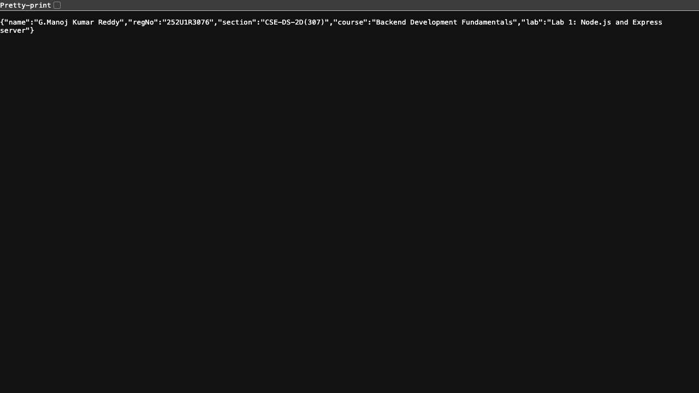
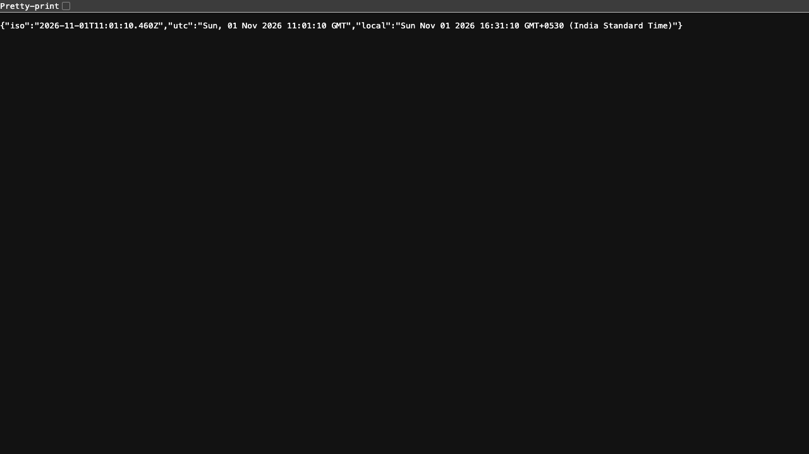
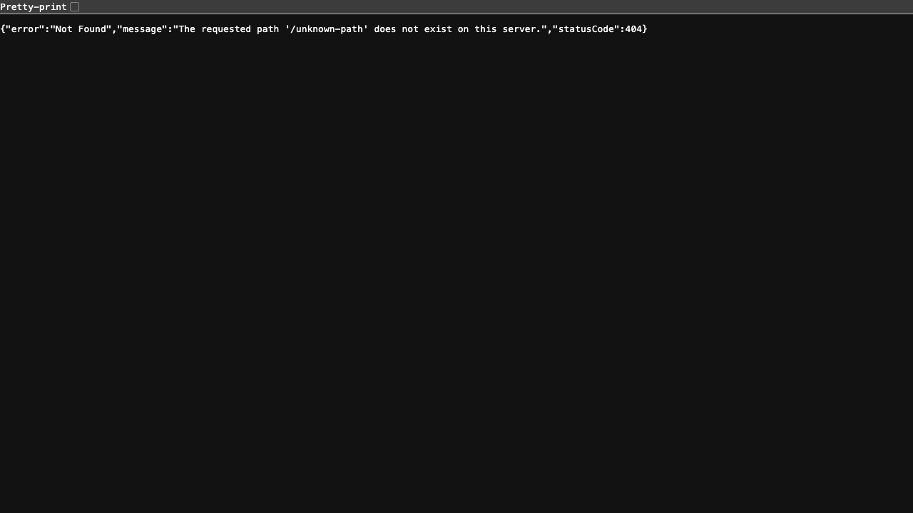

# Lab 1: Node.js and Express server

**Student Name:** G. Manoj Kumar Reddy · **Registration Number:** 252U1R3076 · **Section:** CSE-DS-2D(307)  
**Course:** Backend Development Fundamentals (Year II Term II) · **Institution:** Aurora Deemed to be University  
**Repository Link:** [https://github.com/manojmaverick001-hub/Backend-Development-Fundamentals/tree/main/lab-01](https://github.com/manojmaverick001-hub/Backend-Development-Fundamentals/tree/main/lab-01)  
**Live Link:** [https://backend-development-fundamentals-manoj.vercel.app](https://backend-development-fundamentals-manoj.vercel.app) *(or deploy via Vercel / Render)*

---

## 1. Objective
Set up a Node.js project and build a modular web server, first using Node's built-in `http` module and then rewritten using the `Express` framework with routing, status code handling, and 404 fallback handling.

---

## 2. Explanation of `package.json` Fields
When initializing a Node.js project with `npm init -y`, `package.json` is generated as the project manifest. Below is an explanation of every field:

| Field | Purpose / Description |
| :--- | :--- |
| `"name"` | The lowercase, unique identifier/name for this Node.js package or project (e.g., `"lab-1"`). |
| `"version"` | Follows Semantic Versioning (`MAJOR.MINOR.PATCH`, e.g., `"1.0.0"`). Tracks release iterations. |
| `"description"` | A brief human-readable summary of the package/project purpose. |
| `"main"` | The primary entry point file of the application that gets executed when the package is imported or run (e.g., `"index.js"`). |
| `"scripts"` | Custom terminal alias scripts that can be invoked via `npm run <script-name>` or `npm start` (e.g., `"start": "node index.js"`). |
| `"keywords"` | An array of search keywords to help discover the package in the npm registry. |
| `"author"` | Name or email of the package author/maintainer (`"G.Manoj Kumar Reddy"`). |
| `"license"` | The legal software distribution license (e.g., `"ISC"`). |
| `"type"` | Specifies the module system: `"commonjs"` (uses `require` / `module.exports`) or `"module"` (ESM syntax using `import` / `export`). |
| `"dependencies"` | Production packages and libraries required at runtime (e.g., `"express": "^5.3.0"`). Installed into `node_modules/`. |

---

## 3. How to Run

### A. Prerequisites
- **Node.js** (v18.x or later installed)
- **npm** (v9.x or later installed)

### B. Installation
Clone the repository and install dependencies inside `lab-01`:
```bash
# Clone the repository
git clone https://github.com/manojmaverick001-hub/Backend-Development-Fundamentals.git

# Navigate to the lab-01 folder
cd Backend-Development-Fundamentals/lab-01

# Install required dependencies (Express)
npm install
```

### C. Environment Variables
Create a `.env` file in the `lab-01/` directory if custom ports are needed (optional, default fallbacks are provided in code):
```env
PORT=3000
STUDENT_NAME=G.Manoj Kumar Reddy
STUDENT_REG_NO=252U1R3076
STUDENT_SECTION=CSE-DS-2D(307)
```
*(Note: Never commit `.env` to Git. A `.env.example` template is provided).*

### D. Running the Servers
- **Run the Plain HTTP Server (Task 3):**
  ```bash
  npm run start:http
  # Runs http-server.js on http://localhost:3000
  ```

- **Run the Express Server (Tasks 4–7):**
  ```bash
  npm start
  # Runs index.js on http://localhost:3000
  ```

---

## 4. Endpoints and Scripts Table

### Available NPM Scripts
| Script Command | Description |
| :--- | :--- |
| `npm start` | Runs the Express application server (`node index.js`). |
| `npm run start:http` | Runs the plain Node.js built-in HTTP server (`node http-server.js`). |

### API Endpoints
| HTTP Method | Route Path | Description | Expected Status Code |
| :--- | :--- | :--- | :--- |
| `GET` | `/` | Welcome text message confirming the server is alive. | `200 OK` |
| `GET` | `/about` | Returns student information (Name, Reg No, Section, Course) in JSON format. | `200 OK` |
| `GET` | `/time` | Returns the current server timestamp (ISO, UTC, and Local format) using `new Date()`. | `200 OK` |
| `GET` | `/date` | Returns today's formatted date string. | `200 OK` |
| `*` | Any undefined path (e.g., `/unknown-path`) | Custom 404 JSON response for unhandled routes. | `404 Not Found` |

---

## 5. Screenshots of Working Output

### 1. Plain HTTP Server (`http.createServer`) - Replying "Hello Manoj" (Status: 200 OK)


### 2. Express Server: GET `/` - Welcome Message (Status: 200 OK)


### 3. Express Server: GET `/about` - Student Details (Status: 200 OK)


### 4. Express Server: GET `/time` - Current Date & Time (Status: 200 OK)


### 5. Express Server: GET `/date` - Date String (Status: 200 OK)


### 6. Express Server: GET `/unknown-path` - 404 Error Handling (Status: 404 Not Found)


---

## 6. Notes: Problems Faced & Solutions

1. **Port Conflicts (`EADDRINUSE`)**:
   - *Problem:* Running both `http-server.js` and `index.js` simultaneously on port `3000` causes an `EADDRINUSE` error.
   - *Solution:* Used environment variable `const PORT = process.env.PORT || 3000;` allowing dynamic port assignment, and stopped the plain HTTP server process before starting the Express server.
2. **Preventing `node_modules` from Git Commits**:
   - *Problem:* `node_modules` contains thousands of files and should not be tracked by Git.
   - *Solution:* Added `.gitignore` files at both the repository root and `lab-01/` directory listing `node_modules/` and `.env`.
3. **Handling Undefined Routes (404)**:
   - *Problem:* Express by default sends an HTML 404 page for unmatched routes.
   - *Solution:* Placed a catch-all middleware (`app.use((req, res) => ... )`) at the very end of the route definitions to return a structured JSON response with status code `404`.

---

## 7. Viva Questions & Answers

1. **What is the difference between `package.json` and `node_modules`?**
   - **`package.json`**: The project's configuration file that records metadata, scripts, and specifies dependencies and version constraints.
   - **`node_modules`**: The directory that stores the actual installed code and physical files of all external libraries and their sub-dependencies.

2. **What does `app.listen()` do?**
   - It binds and listens for incoming connections on the specified port (e.g. `3000`) and host, starting the underlying Node HTTP server managed by Express.

3. **What do `request` and `response` represent?**
   - **`request` (`req`)**: An object containing data sent by the client to the server, including HTTP method, URL path, headers, query parameters, and request body.
   - **`response` (`res`)**: An object used by the server to construct and send the HTTP response back to the client, including HTTP status code, headers, and payload (HTML, JSON, plain text).
