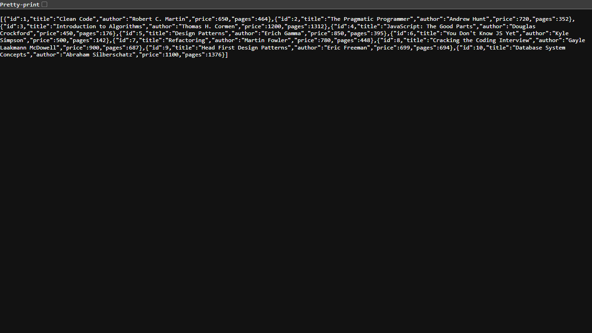
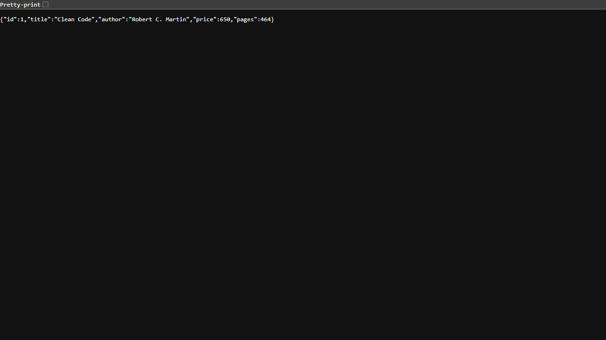
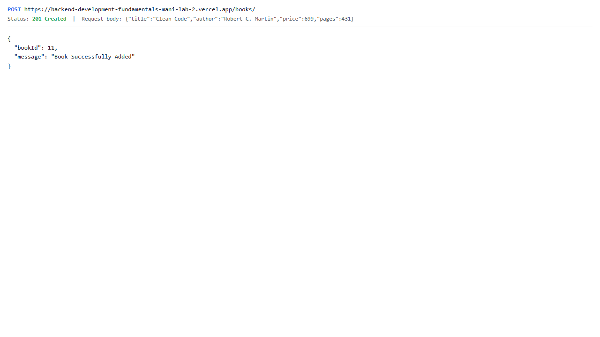
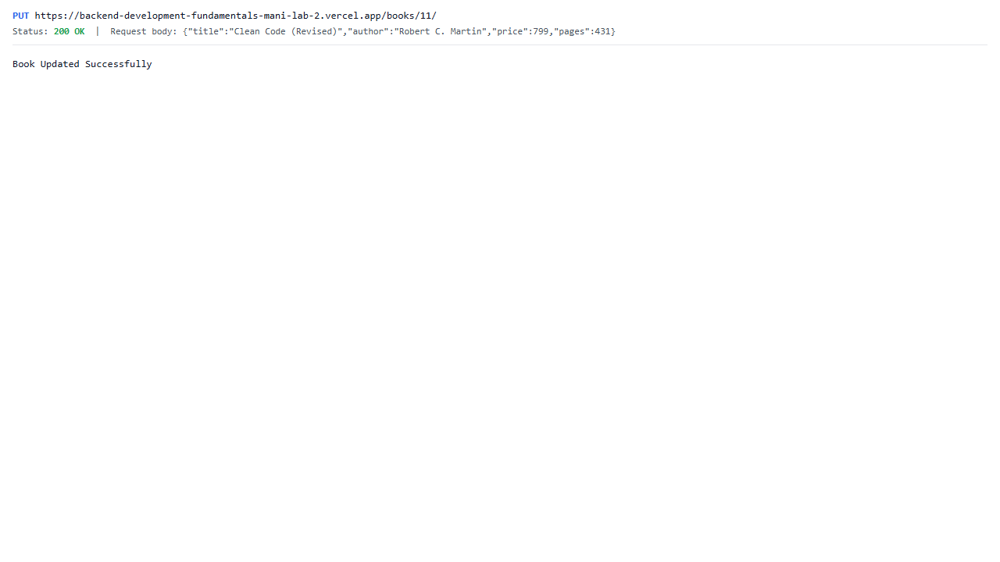
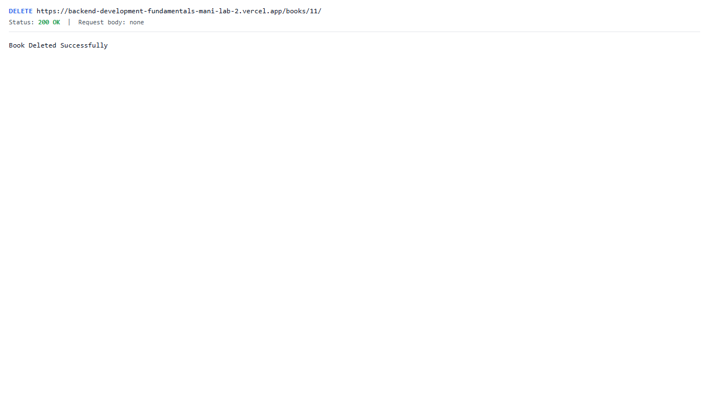
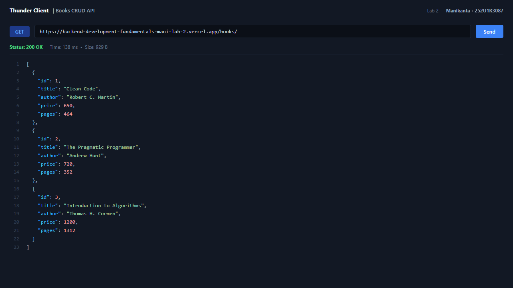

# Lab 2: SQLite database and CRUD routes

**Student Name:** G. Manoj Kumar Reddy · **Registration Number:** 252U1R3076 · **Section:** CSE-DS-2B(307)  
**Course:** Backend Development Fundamentals (Year II Term II) · **Institution:** Aurora Deemed to be University  
**GitHub Repository:** [https://github.com/manojmaverick001-hub/Backend-Development-Fundamentals/tree/main/lab-02](https://github.com/manojmaverick001-hub/Backend-Development-Fundamentals/tree/main/lab-02)  
**Live Link:** [https://backend-development-fundamentals-manoj-lab-2.vercel.app](https://backend-development-fundamentals-manoj-lab-2.vercel.app) *(or deploy via Vercel / Render)*

---

## 1. Objective
Connect an Express.js web server to a local SQLite database (`books.db`) using the `sqlite` and `sqlite3` packages and expose full CRUD (Create, Read, Update, Delete) operations over HTTP using parameterized queries (`?`) to prevent SQL injection.

---

## 2. Database Schema and Initial Seed
The database table `book` is defined in SQLite as:
```sql
CREATE TABLE book (
  id INTEGER PRIMARY KEY AUTOINCREMENT,
  title TEXT NOT NULL,
  author TEXT NOT NULL,
  price INTEGER NOT NULL,
  pages INTEGER NOT NULL
);
```

The database is seeded with 10 initial book records covering computer science and software engineering reference books:
1. *Clean Code* by Robert C. Martin (₹650, 464 pages)
2. *The Pragmatic Programmer* by Andrew Hunt (₹720, 352 pages)
3. *Introduction to Algorithms* by Thomas H. Cormen (₹1200, 1312 pages)
4. *JavaScript: The Good Parts* by Douglas Crockford (₹450, 176 pages)
5. *Design Patterns* by Erich Gamma (₹850, 395 pages)
6. *You Don't Know JS Yet* by Kyle Simpson (₹500, 142 pages)
7. *Refactoring* by Martin Fowler (₹780, 448 pages)
8. *Cracking the Coding Interview* by Gayle Laakmann McDowell (₹900, 687 pages)
9. *Head First Design Patterns* by Eric Freeman (₹699, 694 pages)
10. *Database System Concepts* by Abraham Silberschatz (₹1100, 1376 pages)

---

## 3. How to Run

### A. Prerequisites
- **Node.js** (v18.x or later installed)
- **npm** (v9.x or later installed)

### B. Installation
Clone the repository and install all dependencies:
```bash
# Clone the repository
git clone https://github.com/manojmaverick001-hub/Backend-Development-Fundamentals.git

# Navigate into the lab-02 directory
cd Backend-Development-Fundamentals/lab-02

# Install dependencies
npm install
```

### C. Environment Variables
Create a `.env` file in the `lab-02/` directory if needed (optional, default fallbacks are configured in code):
```env
PORT=3000
STUDENT_NAME=G. Manoj Kumar Reddy
STUDENT_REG_NO=252U1R3076
STUDENT_SECTION=CSE-DS-2B(307)
```
*(Note: Never commit `.env` to Git. A `.env.example` template is provided).*

### D. Database Initialization (Optional / Reset)
To regenerate or reset the `books.db` SQLite database with the initial 10 records:
```bash
node init-db.js
```

### E. Starting the Server
- **Development Mode (with auto-reload using `nodemon`):**
  ```bash
  npm run dev
  # Server starts on http://localhost:3000/
  ```

- **Production Mode:**
  ```bash
  npm start
  ```

---

## 4. Endpoints and HTTP Methods

| HTTP Method | Route Path | Description | Expected Status Code | Request Body / Params |
| :--- | :--- | :--- | :--- | :--- |
| `GET` | `/` | Root API welcome message | `200 OK` | None |
| `GET` | `/books/` | Retrieves all books ordered by ID | `200 OK` | None |
| `GET` | `/books/:bookId/` | Retrieves a single book by primary key ID | `200 OK` / `404 Not Found` | `bookId` (route param) |
| `POST` | `/books/` | Inserts a new book into the database | `201 Created` | JSON: `{ title, author, price, pages }` |
| `PUT` | `/books/:bookId/` | Updates an existing book's details by ID | `200 OK` / `404 Not Found` | `bookId` + JSON update fields |
| `DELETE` | `/books/:bookId/` | Deletes a book from the database by ID | `200 OK` | `bookId` (route param) |

---

## 5. Screenshots of Working Endpoints

### 1. GET `/books/` - Fetch All Books


### 2. GET `/books/:bookId/` - Fetch Single Book by ID


### 3. POST `/books/` - Add New Book (Returns 201 Created)


### 4. PUT `/books/:bookId/` - Update Existing Book


### 5. DELETE `/books/:bookId/` - Delete Book by ID


### 6. Error Handling: GET `/books/999/` (404 Not Found)


### 7. SQLite CLI Table View (`sqlite3 books.db`)


---

## 6. Notes: Problems Faced & Solutions

1. **Race Condition Between Database Connection and Server Start:**
   - *Problem:* Calling `app.listen()` before the SQLite connection has resolved leads to incoming HTTP requests querying an uninitialized `db = null` reference, causing runtime crashes.
   - *Solution:* Implemented the `initializeDBAndServer()` async function that uses `await sqlite.open(...)` to ensure the database connection is fully established before invoking `app.listen(PORT)`.

2. **Preventing SQL Injection with Parameterized Queries:**
   - *Problem:* Concatenating user inputs directly into SQL strings (e.g., `WHERE id = ${bookId}`) exposes the database to SQL injection attacks.
   - *Solution:* Used `?` placeholders in every query (`SELECT * FROM book WHERE id = ?;`), passing inputs as parameter arrays (`[bookId]`) so the SQLite engine treats inputs strictly as literal values.

3. **Handling Missing JSON Request Body:**
   - *Problem:* In POST and PUT requests, `request.body` is `undefined` without the Express JSON body-parser middleware.
   - *Solution:* Added `app.use(express.json());` at the top of the middleware stack so incoming JSON bodies are parsed into JavaScript objects.

---

## 7. Viva Questions & Answers

1. **What is the difference between `db.get()` and `db.all()` in the `sqlite` package?**
   - **`db.get(query, params)`**: Executes the SQL query and returns only the **first matching row** as an object, or `undefined` if no row matches (ideal for `SELECT * ... WHERE id = ?`).
   - **`db.all(query, params)`**: Executes the SQL query and returns **all matching rows** as an array of objects (ideal for fetching all books `SELECT * FROM book`).

2. **What is SQL Injection and how do parameterized queries prevent it?**
   - **SQL Injection**: A security vulnerability where an attacker injects malicious SQL statements via user input fields, potentially altering database queries, stealing data, or deleting tables.
   - **Parameterized Queries**: Separate the SQL code structure from the user input by using placeholders (`?`). The database engine treats the parameters strictly as literal data values rather than executable SQL commands.

3. **What is the purpose of `express.json()` middleware?**
   - It is a built-in Express middleware that parses incoming HTTP requests with `Content-Type: application/json` and populates `request.body` with the parsed JavaScript object.
