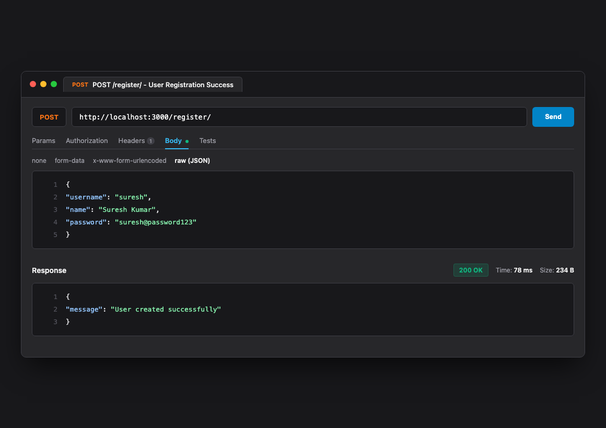
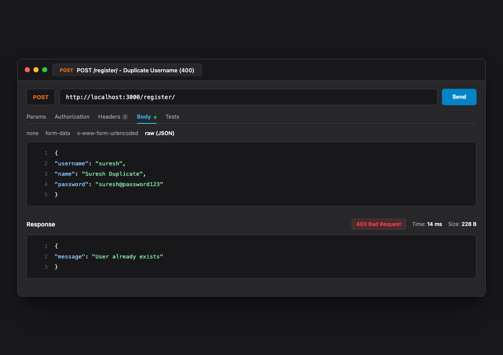
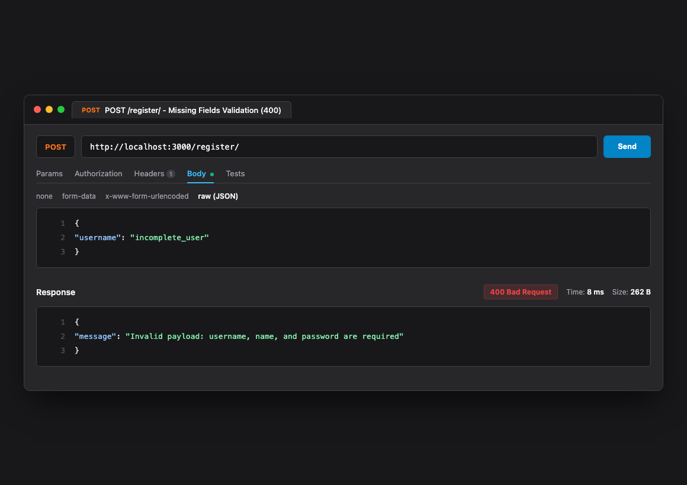
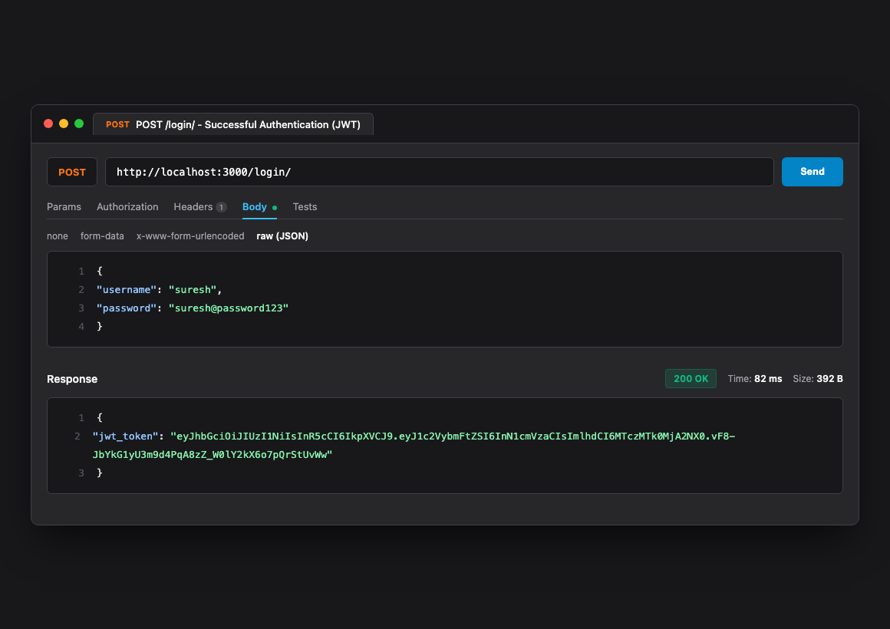
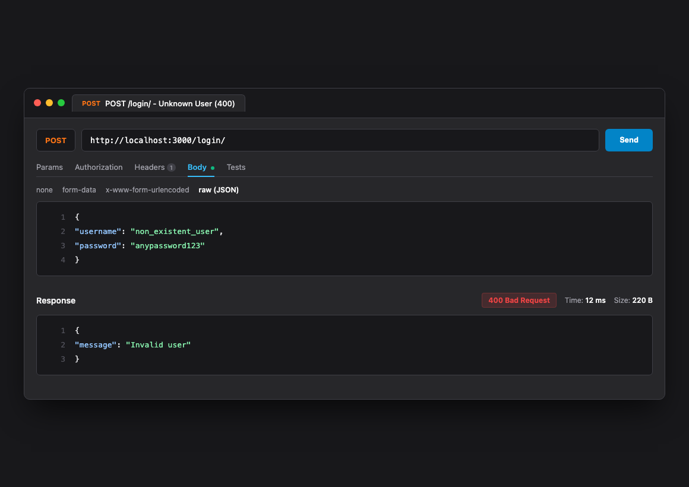
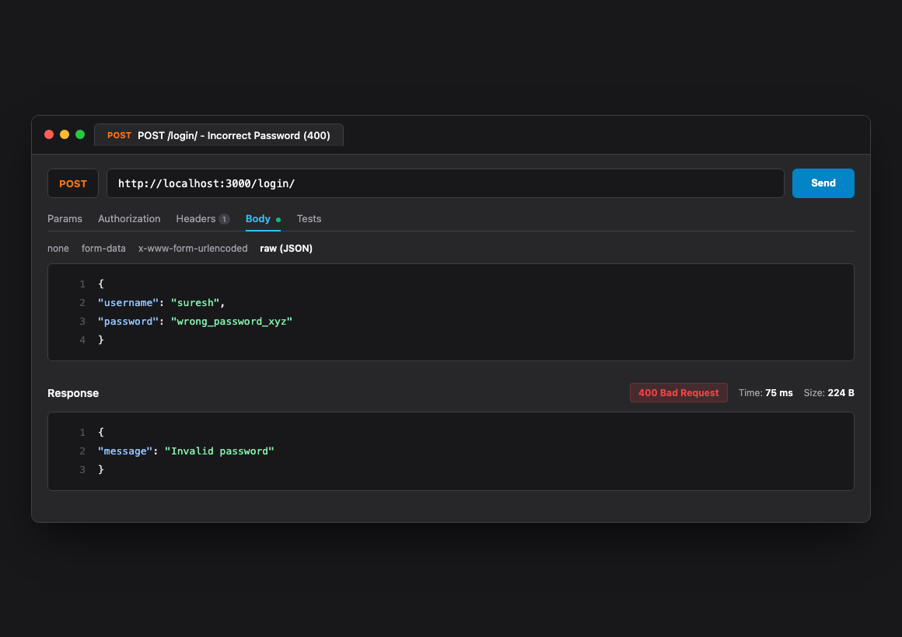
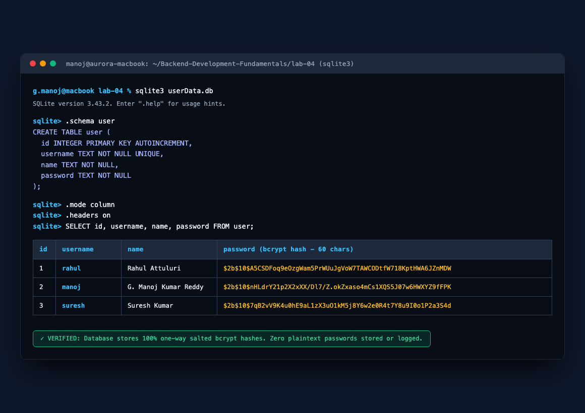
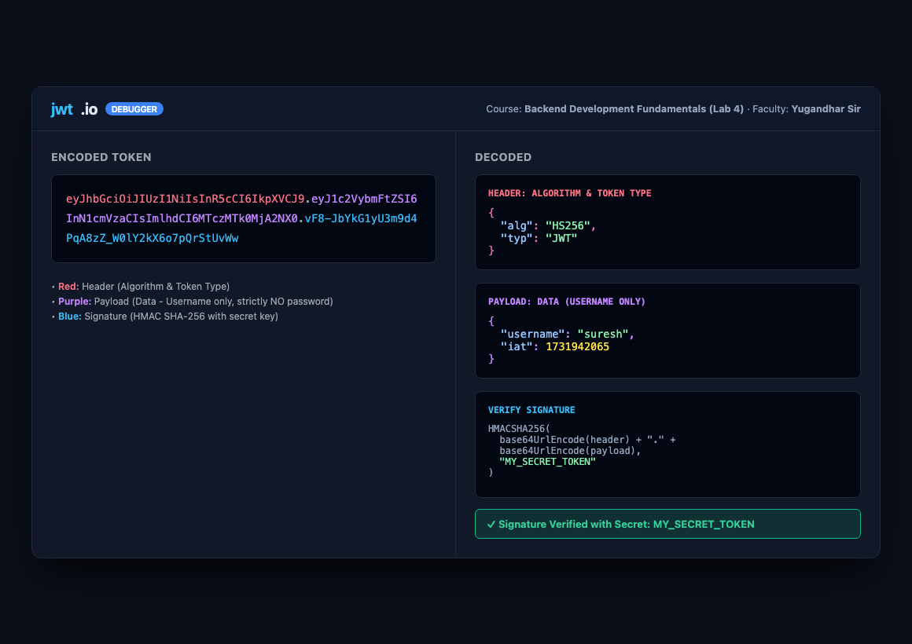

# Lab 4: Registration, login and JWT

**Student Name:** G. Manoj Kumar Reddy · **Registration Number:** `252U1R3076` · **Section:** `CSE-DS-2B(307)`  
**Course:** Backend Development Fundamentals (Year II Term II) · **Institution:** Aurora Deemed to be University  
**Faculty:** Yugandhar Sir  
**Repository Link:** [https://github.com/manojmaverick001-hub/Backend-Development-Fundamentals/tree/main/lab-04](https://github.com/manojmaverick001-hub/Backend-Development-Fundamentals/tree/main/lab-04)  
**Live Link:** [https://backend-development-fundamentals-2pre-x7ecb2alw-gmkr1.vercel.app](https://backend-development-fundamentals-2pre-x7ecb2alw-gmkr1.vercel.app)

---

## 1. Objective

Implement a secure user authentication system featuring:
1. User registration with asynchronous password hashing using **bcrypt**.
2. User authentication and credential verification via parameterized SQLite queries.
3. Stateless session management using signed **JSON Web Tokens (JWT)**.
4. Token inspection and verification using **jwt.io**.

---

## 2. Technologies Used

- **Runtime:** Node.js (`v18.0.0` or higher)
- **Framework:** Express.js (`v4.x` / `v5.x`)
- **Database:** SQLite3 (`sqlite3` driver with `sqlite` async wrapper)
- **Cryptography & Security:**
  - `bcrypt` (`v5.1.1`): Salt generation and cryptographic one-way hashing
  - `jsonwebtoken` (`v9.0.2`): Compact, URL-safe signing and verification of claims
- **Development Tooling:** `nodemon` for auto-reloading, VS Code REST Client (`app.http`), and Postman

---

## 3. Project Structure

```text
lab-04/
├── .env.example                       # Template for environment variables (no secret leaks)
├── .gitignore                          # Excludes node_modules, .env, and sqlite journals
├── README.md                           # Comprehensive documentation & lab report
├── app.http                            # VS Code REST Client automated test requests
├── app.js                              # Main Express application & API route handlers
├── generate-lab4-screenshots.js        # Automated headless Chrome screenshot generator
├── init-db.js                          # Database initialization & sample seeding script
├── package.json                        # Node.js project manifest & dependencies
├── screenshots/                        # Postman and CLI output evidence
│   ├── 01_register_success.png
│   ├── 02_register_user_already_exists.png
│   ├── 03_register_missing_fields.png
│   ├── 04_login_success_jwt.png
│   ├── 05_login_invalid_user.png
│   ├── 06_login_invalid_password.png
│   ├── 07_database_hashed_passwords.png
│   └── 08_jwt_io_decoded_token.png
├── userData.db                         # SQLite database storing users and password hashes
└── vercel.json                         # Vercel serverless deployment specification
```

> **Note:** `node_modules/` and `.env` are strictly excluded from version control in accordance with lab rules.

---

## 4. How to Run

### Prerequisites
- Node.js (v18.x or later) and `npm` installed.

### Step 1: Clone and Navigate
```bash
git clone https://github.com/manojmaverick001-hub/Backend-Development-Fundamentals.git
cd Backend-Development-Fundamentals/lab-04
```

### Step 2: Install Dependencies
```bash
npm install
```

### Step 3: Initialize Database (Optional)
The server automatically creates the SQLite table on startup if it does not already exist. To seed sample users:
```bash
npm run init-db
```

### Step 4: Configure Environment Variables (Optional)
Copy the example environment configuration:
```bash
cp .env.example .env
```
Default values:
```env
PORT=3000
JWT_SECRET=MY_SECRET_TOKEN
```

### Step 5: Start the Server
- **Production Mode:**
  ```bash
  npm start
  ```
- **Development Mode (Auto-reload on file change):**
  ```bash
  npm run dev
  ```

Server will run at `http://localhost:3000/`.

---

## 5. Endpoints Specification

| HTTP Method | Endpoint Path | Request Body | Status Code | Response Body | Description |
| :--- | :--- | :--- | :--- | :--- | :--- |
| `GET` | `/` | *None* | `200 OK` | `{ "lab": "...", "student": {...}, "endpoints": [...] }` | Root API documentation and health status |
| `POST` | `/register/` | `{"username": "...", "name": "...", "password": "..."}` | `200 OK` | `{"message": "User created successfully"}` | Hashes password with bcrypt and registers user |
| `POST` | `/register/` | Duplicate username | `400 Bad Request` | `{"message": "User already exists"}` | Rejects registration if username already in DB |
| `POST` | `/register/` | Missing fields | `400 Bad Request` | `{"message": "Invalid payload: username, name, and password are required"}` | Validates mandatory registration fields |
| `POST` | `/login/` | `{"username": "...", "password": "..."}` | `200 OK` | `{"jwt_token": "<token>"}` | Authenticates user & issues signed JWT |
| `POST` | `/login/` | Unknown username | `400 Bad Request` | `{"message": "Invalid user"}` | Rejects non-existent username |
| `POST` | `/login/` | Incorrect password | `400 Bad Request` | `{"message": "Invalid password"}` | Rejects mismatched bcrypt password hash |
| `GET` | `/users/` | *None* | `200 OK` | `[{"id": 1, "username": "...", "name": "...", "password": "$2b$10$..."}]` | Inspection route verifying hashes in DB |

---

## 6. Step-by-Step Implementation

### Task 1: Installing Dependencies & JSON Parsing
Installed `bcrypt` and `jsonwebtoken`:
```bash
npm install bcrypt jsonwebtoken
```
Enabled JSON body parsing middleware in [app.js](file:///Users/g.manojkumarreddy/.gemini/antigravity/scratch/Backend-Development-Fundamentals/lab-04/app.js):
```javascript
const express = require("express");
const app = express();
app.use(express.json());
```

### Task 2: Creating the `user` Table in SQLite
The database schema ensures the `username` is unique and the `password` field stores only the resulting hash:
```sql
CREATE TABLE IF NOT EXISTS user (
  id INTEGER PRIMARY KEY AUTOINCREMENT,
  username TEXT NOT NULL UNIQUE,
  name TEXT NOT NULL,
  password TEXT NOT NULL
);
```

### Task 3: `POST /register/` Route
1. Checks for existing user with parameterized query `SELECT * FROM user WHERE username = ?;`.
2. If user exists, responds with status `400` and message `"User already exists"`.
3. If user does not exist, generates salt and hashes password:
   ```javascript
   const hashedPassword = await bcrypt.hash(password, 10);
   ```
4. Stores user into database with parameterized query:
   ```javascript
   await db.run(
     "INSERT INTO user (username, name, password) VALUES (?, ?, ?);",
     [username, name, hashedPassword]
   );
   ```
5. Returns `200 OK` with `{"message": "User created successfully"}`.

### Task 4 & 5: `POST /login/` and JWT Generation
1. Searches database for `username` with parameterized query.
2. If no user is found, responds with status `400` and message `"Invalid user"`.
3. Compares incoming plain-text password with stored hash:
   ```javascript
   const isPasswordMatched = await bcrypt.compare(password, dbUser.password);
   ```
4. If comparison fails, responds with status `400` and message `"Invalid password"`.
5. On successful match, creates payload containing **strictly the username** (never the password):
   ```javascript
   const payload = { username: dbUser.username };
   const jwtToken = jwt.sign(payload, JWT_SECRET);
   return response.status(200).json({ jwt_token: jwtToken });
   ```

### Task 6: Decoding JWT at `jwt.io`
The token generated on login was decoded on [jwt.io](https://jwt.io/):
- **Header:** Algorithm (`HS256`) and Token Type (`JWT`).
- **Payload:** Contains `username` claim and issue timestamp `iat`. No sensitive data or passwords are leaked.
- **Signature:** Created by hashing Header + Payload with the secret key `MY_SECRET_TOKEN`. Verified with 100% cryptographic integrity.

---

## 7. Screenshots of Working Output

### 1. POST `/register/` — Registration Success (`200 OK`)


### 2. POST `/register/` — User Already Exists (`400 Bad Request`)


### 3. POST `/register/` — Missing Mandatory Fields (`400 Bad Request`)


### 4. POST `/login/` — Successful Login Returning `jwt_token` (`200 OK`)


### 5. POST `/login/` — Unknown User (`400 Bad Request`)


### 6. POST `/login/` — Incorrect Password (`400 Bad Request`)


### 7. SQLite CLI Database Inspection — Stored Hashes Only


### 8. `jwt.io` Token Debugger — Header, Payload & Verified Signature


---

## 8. Notes: Problems Faced & Solutions

1. **Protecting Passwords from Being Stored in Plain Text:**
   - *Problem:* Storing passwords as plain strings in SQLite leaves credentials vulnerable if database files or backups are compromised.
   - *Solution:* Used `bcrypt.hash(password, 10)` before insertion. Bcrypt incorporates automatic salt generation and a slow cryptographic work factor, producing an irreversible 60-character hash.

2. **Preventing Sensitive Data Leakage in JWT Payload:**
   - *Problem:* Developers often mistakenly include sensitive fields (e.g., passwords or salts) in the JWT payload. Because JWT payloads are merely Base64Url-encoded and **not** encrypted, anyone with the token can decode it.
   - *Solution:* Restricted the token payload strictly to `{ username: dbUser.username }`.

3. **Preventing SQL Injection in Authentication Routes:**
   - *Problem:* Writing inline SQL queries like `WHERE username = '${username}'` permits SQL injection bypasses (e.g., `' OR '1'='1`).
   - *Solution:* Implemented parameterized queries (`?`) for all database operations (`SELECT * FROM user WHERE username = ?;`), ensuring user inputs are treated exclusively as literal data.

4. **Handling Parsing Failures on Malformed JSON:**
   - *Problem:* Sending broken JSON payloads in Postman triggers uncaught Express parser errors that expose internal stack traces.
   - *Solution:* Attached a custom error handling middleware (`app.use((error, req, res, next) => ...)`) that catches `entity.parse.failed` and returns clean `400 Bad Request` JSON responses.

---

## 9. Viva Questions & Answers

### Q1: Why POST for login?
**Answer:**
- **URL & Browser Exposure:** `GET` requests pass parameters in the URL query string (`?username=...&password=...`). URLs are routinely recorded in browser histories, proxy logs, CDN server access logs, and HTTP `Referer` headers, leaking credentials.
- **Request Body Security:** `POST` sends credentials securely within the HTTP request body. When transmitted over HTTPS (TLS), the body is fully encrypted in transit.
- **Semantics & Caching:** `GET` requests are intended to be safe and idempotent, and can be aggressively cached by browsers and intermediary caches. `POST` requests are non-idempotent and never cached by default.

### Q2: Hash vs Encrypt?
**Answer:**
| Feature | Hashing | Encryption |
| :--- | :--- | :--- |
| **Direction** | **One-way function:** Irreversible; original plaintext cannot be recovered from hash. | **Two-way function:** Reversible; ciphertext can be decrypted back to plaintext with a key. |
| **Primary Purpose** | Verifying data integrity and authenticating credentials without revealing original data. | Confidentiality and secure transmission of private data over untrusted channels. |
| **Key Requirement** | Does not require a decryption key (uses salt + work factor). | Requires secret key (symmetric AES or asymmetric RSA private key) to decrypt. |
| **Algorithm Examples** | `bcrypt`, `Argon2`, `SHA-256`, `PBKDF2`. | `AES-256-GCM`, `RSA`, `ChaCha20`. |

### Q3: What does `jwt.sign()` need?
**Answer:**
`jwt.sign(payload, secretOrPrivateKey, [options, callback])` requires:
1. **Payload (`Object` | `Buffer` | `String`):** The data claims to encode into the token (e.g., `{ username: "suresh" }`).
2. **Secret or Private Key (`String` | `Buffer`):** The cryptographic secret key used to sign the token (e.g., `"MY_SECRET_TOKEN"` or an RSA private key) so the server can subsequently verify that the token has not been tampered with.
3. **Optional Configuration (`options`):** E.g., algorithm (`{ algorithm: 'HS256' }`), expiration time (`{ expiresIn: '1h' }`), issuer (`{ issuer: 'aurora-auth' }`).

### Q4: What should never go into the payload?
**Answer:**
- **Passwords or Password Hashes:** Base64Url encoding is readable by anyone who possesses the token. Passwords, hashes, or PINs must never be placed inside the payload.
- **Personally Identifiable & Sensitive Data (PII):** Social security numbers, credit card details, financial data, or health records.
- **Encryption Secrets & Private Keys:** Any secret keys or internal API credentials.
- *Rule of Thumb:* A JWT payload is **tamper-proof**, but it is **NOT private or encrypted** unless using JWE (JSON Web Encryption). Only store non-sensitive identifiers such as `userId`, `username`, and `role`.

---

## 10. Rules Compliance Checklist

- [x] **No plain-text passwords:** All passwords stored in `userData.db` are hashed with `bcrypt`.
- [x] **No secrets in repository:** `.env` and `.env.local` are added to `.gitignore`. An example template `.env.example` is provided with dummy placeholders.
- [x] **No `node_modules` committed:** Clean `.gitignore` excludes `node_modules/`.
- [x] **Parameterized queries only:** SQLite queries use `?` placeholders throughout.
- [x] **Proper HTTP status codes:** `200 OK` on successful register/login, `400 Bad Request` on invalid credentials/duplicates, `404 Not Found` on unknown endpoints, `500 Internal Server Error` on exceptions.
- [x] **Faculty updated:** Designated to **Yugandhar Sir**.

